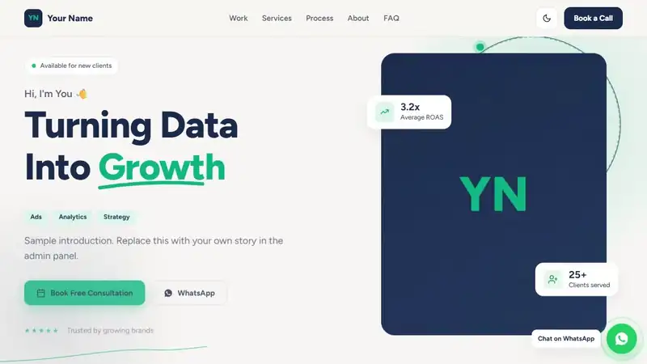
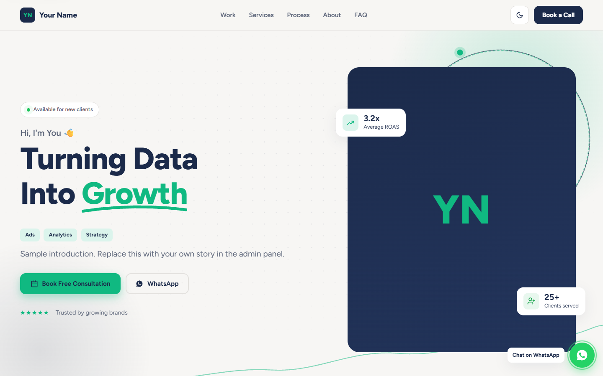
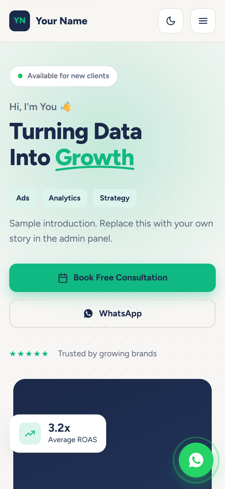
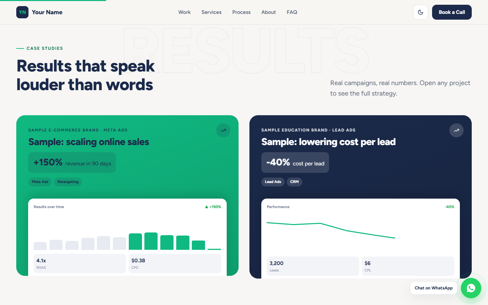
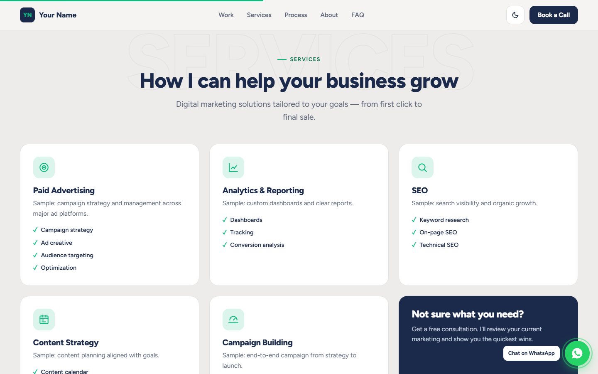
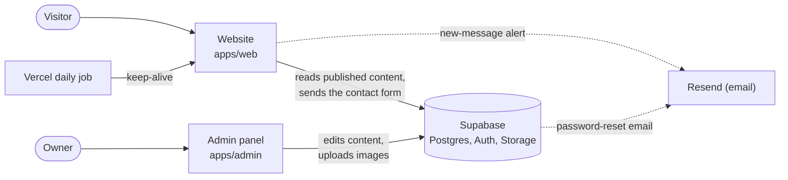

<div align="center">


<br>


**A portfolio website with its own admin panel.** The owner edits every section, publishes case studies and reads enquiries without touching code. Free to host, ready for a custom domain.

<sub>Created by <a href="https://github.com/tamjidul04">tamjidul04</a></sub>

[Set it up with Claude](#set-it-up-with-claude) · [Quick start](#quick-start) · [Go live for free](#go-live-for-free) · [Custom domain](#custom-domain) · [Troubleshooting](#troubleshooting)

<br>



</div>

<br>

> **Placeholder content only.** This repository ships with sample text and no personal data. A real person's content lives in their own private deployment and database. Never commit real content, photos, keys or `.env` files. Every picture in this README was captured from the placeholder content.

## Overview

| | Website `apps/web` | Admin panel `apps/admin` |
|---|---|---|
| **For** | Visitors | The owner |
| **Example address** | `yourdomain.com` | `admin.yourdomain.com` |
| **Does** | Home page, case studies, privacy page, consultation form, WhatsApp button | Sign-in, edit all content, upload images, reorder by drag and drop, inbox with private notes |
| **Highlights** | Responsive from 280&nbsp;px to 4K, scroll animation, light and dark mode, SEO, optional Meta Pixel and GA4 | Password reset, uploads resized automatically, email alerts for new messages |

<table>
  <tr>
    <td width="68%"></td>
    <td width="32%"></td>
  </tr>
  <tr>
    <td></td>
    <td></td>
  </tr>
</table>

<details>
<summary><b>How the pieces fit together</b></summary>

<br>



Both apps are deployed as separate Vercel projects from the same repository. All content lives in one Supabase project, protected by row-level security. The website can only read published content; only signed-in admins can write.

</details>

## Set it up with Claude

Don't want to set this up by hand, or got stuck? Open [Claude Code](https://claude.com/claude-code) (in a terminal or in VS Code) in an empty folder and paste one of these prompts. Each one contains this repository's link, so Claude downloads the code itself, reads this README, runs the commands for you, and walks you through every click one step at a time. You don't need to clone or paste anything first.

A few honest limits: Claude cannot create accounts, sign in for you, pay for anything or verify a domain. You do those parts yourself, and the prompts tell Claude to wait for you. The prompts cost nothing, and the free setup uses only free plans. You do need your own access to Claude. In the regular Claude chat app, Claude can guide you but cannot run commands.

<details>
<summary><b>Prompt 1: free setup (Vercel Hobby + Supabase Free)</b></summary>

<br>

```text
I want to put this portfolio template online using only free plans (Vercel Hobby and
Supabase Free). Please do the whole setup with me, one step at a time.

REPOSITORY
https://github.com/tamjidul04/Marketing_Portfolio
- If the current folder is not already a copy of that repository, clone it yourself:
  git clone https://github.com/tamjidul04/Marketing_Portfolio.git my-portfolio
  then work inside my-portfolio. I should not have to download or paste anything.
- If the clone is refused because the repository is private, help me sign in with
  "gh auth login" (I complete the login in my browser), or tell me to ask the owner
  for access.
- Do NOT push to that original repository. In step 6 you will help me create my own copy.
- Read README.md before doing anything else, especially "Quick start", "Go live for
  free", "Environment variables" and "Keeping the free database awake".

CONTEXT
- There are two Next.js apps, apps/web (website) and apps/admin (admin panel), and a
  Supabase database defined in supabase/migrations.

HOW TO WORK
- One step at a time. Tell me exactly what to click or type, wait for me to say "done",
  then continue. Assume I am a beginner and explain each step in plain words.
- Run commands yourself where you can. Ask me before anything that creates, deletes,
  publishes or pushes something.
- I will create accounts and sign in myself (GitHub, Vercel, Supabase). Never ask me to
  paste passwords or secret keys into this chat. The only values that may appear here are
  the Supabase project URL and the publishable (anon) key, which are public by design.
  Never use or ask for the service_role / secret key.
- Never commit .env files, keys or personal data. Keep my GitHub repository PRIVATE.
- If something fails, show me the error, explain it simply, and fix it before moving on.

WHAT I WANT DONE
1. Check that Node 20+ is installed and run npm install.
2. Help me create a free Supabase project. Apply supabase/migrations (CLI or SQL editor)
   and, if I want sample content, supabase/seed/demo_content.sql.
3. Create apps/web/.env.local and apps/admin/.env.local from .env.example, generating
   long random values for CONTACT_HASH_SALT and AUTH_HASH_SALT (different from each other).
4. Create my admin user in Supabase and add it to public.admins.
5. Run both apps locally and check them: website on :3000, admin on :3001, send a test
   message through the contact form and find it in the admin Inbox, then delete it.
6. Create my own new PRIVATE GitHub repository, point this project's "origin" at it (so
   the original is no longer where pushes go), and push my copy of the code there.
7. Deploy two Vercel projects from that repository (Root Directory apps/web and
   apps/admin) with the right environment variables, and make each project answer at the
   exact address saved in NEXT_PUBLIC_SITE_URL and NEXT_PUBLIC_ADMIN_URL.
8. In Supabase, set the Site URL and Redirect URLs to the admin address and confirm that
   public sign-ups are turned off. Confirm the daily keep-alive in apps/web/vercel.json
   is deployed so the free database does not pause.
9. Finish with a checklist: website loads, admin signs in, a test message reaches the
   Inbox, the sitemap shows the right address.
```

</details>

<details>
<summary><b>Prompt 2: paid plans, custom domain, email, or a different Supabase project</b></summary>

<br>

```text
This portfolio template is already running (or running locally). I now want to upgrade it:
a custom domain, professional email, and/or paid plans. Please do this with me, one step
at a time.

REPOSITORY
https://github.com/tamjidul04/Marketing_Portfolio
- If the current folder is already MY copy of this project (its git "origin" is my own
  repository), use it as it is.
- Otherwise clone the template yourself so I do not have to:
  git clone https://github.com/tamjidul04/Marketing_Portfolio.git my-portfolio
  and work inside my-portfolio. If the clone is refused because the repository is
  private, help me sign in with "gh auth login" (I complete the login in my browser),
  or tell me to ask the owner for access.
- Never push to the original template repository. Changes go to my own repository.
- Read README.md before doing anything else, especially "Custom domain", "Email: alerts
  and password reset", "Free vs paid" and "Using a different database".

CONTEXT
- apps/web is the website, apps/admin is the admin panel. Both are separate Vercel
  projects from the same repository. Content, sign-in and images live in Supabase.

HOW TO WORK
- One step at a time. Tell me exactly what to click or type, wait for me to say "done",
  then continue. Assume I am a beginner and explain each step in plain words.
- Run commands yourself where you can. Ask me before anything that creates, deletes,
  publishes, pushes or changes billing.
- I will buy the domain, upgrade plans, pay, sign in and verify DNS myself. You guide me.
  Never ask me to paste passwords or secret keys into this chat (the Resend API key goes
  straight into Vercel, not here). Never use or ask for the Supabase service_role key.
- Never commit .env files, keys or personal data.
- Before any risky change (moving data, changing the Supabase project), make a backup
  and tell me how to undo it.

WHAT I WANT (do only the parts I choose; ask me first)
A. Custom domain
   - Website on yourdomain.com (and www), admin on admin.yourdomain.com.
   - Add both domains in the right Vercel projects and give me the exact DNS records
     Vercel shows. Wait with me for them to turn valid.
   - Update NEXT_PUBLIC_SITE_URL and NEXT_PUBLIC_ADMIN_URL in both projects and redeploy.
   - Update the Supabase Site URL and Redirect URLs to the new admin address.
B. Email
   - Set up Resend with my domain, then RESEND_API_KEY, CONTACT_NOTIFY_EMAIL and
     RESEND_FROM in the website project.
   - Connect Resend as Supabase's custom SMTP sender, then update the password-reset
     email template as described in the README.
C. Paid plans
   - Explain which plans I need (Vercel Pro for a business site, Supabase Pro if I want
     backups and no pausing) and walk me through upgrading, only when I say so.
D. A different Supabase project (only if I ask)
   - Create the schema in the new project, copy the content and the media bucket, create
     the admin user, update the variables in both Vercel projects, redeploy and verify.
E. Final checks
   - Both sites load over https, /sitemap.xml lists the new domain, a test message reaches
     the admin Inbox and (if set up) the alert email, sign-in works, password reset
     works, public sign-ups are off.
```

</details>

## Quick start

You need **Node.js 20 or newer** and a free [Supabase](https://supabase.com) account. [Resend](https://resend.com) (email) and the Supabase CLI (`npx supabase`) are optional.

**1. Install**

```bash
npm install
```

**2. Create the database.** In Supabase, create a project and note the *Project URL* and the *publishable (anon) key* under *Project Settings → API*. Then apply the schema, either with the CLI:

```bash
npx supabase link --project-ref YOUR-PROJECT-REF
npx supabase db push --remote
```

or by pasting each file in `supabase/migrations/` into the SQL editor, oldest first. For sample content, also run `supabase/seed/demo_content.sql` (skip this for a live site).

**3. Configure.** Copy the example file into both apps and fill it in using the [variables table](#environment-variables):

```bash
cp .env.example apps/web/.env.local
cp .env.example apps/admin/.env.local
```

**4. Create the admin account.** In Supabase, open *Authentication → Users → Add user* and create the owner. Then, in the SQL editor, make that user an admin. This is the only way to add one; there is deliberately no API for it.

```sql
insert into public.admins (user_id)
select id from auth.users where email = 'you@example.com';
```

**5. Run it**

```bash
npm run dev:web     # website  → http://localhost:3000
npm run dev:admin   # admin    → http://localhost:3001
```

Sign in at `http://localhost:3001/login`. Edits appear on the website within about a minute.

## Environment variables

| Variable | App | Value |
|---|---|---|
| `NEXT_PUBLIC_SUPABASE_URL` | both | Your Supabase project URL |
| `NEXT_PUBLIC_SUPABASE_ANON_KEY` | both | The publishable (anon) key. Never the `service_role` or secret key |
| `NEXT_PUBLIC_SITE_URL` | both | Public website address, e.g. `https://yourdomain.com` (`http://localhost:3000` locally) |
| `NEXT_PUBLIC_ADMIN_URL` | both | Admin address, e.g. `https://admin.yourdomain.com` (`http://localhost:3001` locally) |
| `CONTACT_HASH_SALT` | web | Long random string, used to hash visitor IPs for rate limiting |
| `AUTH_HASH_SALT` | admin | A different long random string, for the sign-in limit |
| `RESEND_API_KEY` | web | Optional. Turns on email alerts for new messages |
| `CONTACT_NOTIFY_EMAIL` | web | Optional. Where alerts go (up to three addresses, comma-separated) |
| `RESEND_FROM` | web | Optional sender, e.g. `Website <hello@yourdomain.com>`. Needs a verified domain |
| `CRON_SECRET` | web | Optional. When set, only the daily keep-alive job may call `/api/keepalive` |

Generate a salt with `node -e "console.log(require('crypto').randomBytes(32).toString('hex'))"`. Keep salts secret and different from each other.

> **About Vercel's `NEXT_PUBLIC_` warning.** Vercel warns about names that start with `NEXT_PUBLIC_` and contain `KEY`. The Supabase URL and publishable key are meant to be public, since every browser receives them; your protection is the database's row-level security. Keep the names exactly as written. These values are baked in when the site is built, so after changing one you must **redeploy**.

## Go live for free

Vercel's Hobby plan and Supabase's free plan are enough to launch. You get temporary `*.vercel.app` addresses until you add a domain.

1. **Push the repository to GitHub** and keep it private.
2. **Sign up at [vercel.com](https://vercel.com)** with GitHub (choose Hobby) and let it see the repository.
3. **Create the website project:** *Add New → Project → Import*.
   - Root Directory: `apps/web` (use *Edit* to choose it)
   - Variables: `NEXT_PUBLIC_SUPABASE_URL`, `NEXT_PUBLIC_SUPABASE_ANON_KEY`, `NEXT_PUBLIC_SITE_URL`, `NEXT_PUBLIC_ADMIN_URL`, `CONTACT_HASH_SALT`
   - Click *Deploy*.
4. **Create the admin project:** import the **same repository again**.
   - Root Directory: `apps/admin`
   - Variables: the same four `NEXT_PUBLIC_` values plus `AUTH_HASH_SALT`
5. **Make the addresses match.** Vercel may assign a different address from the one you typed into the variables (for example `my-site-rosy.vercel.app`). In each project open *Settings → Domains → Add Existing* and add the exact address used in `NEXT_PUBLIC_SITE_URL` or `NEXT_PUBLIC_ADMIN_URL`. Then no variable needs editing.
6. **Tell Supabase the admin address,** which password reset needs. Under *Authentication → URL Configuration*, set *Site URL* to the admin address and add `https://your-admin-address/**` to *Redirect URLs*.
7. **Test it.** Open the website and send a message through the form. Sign in to the admin, find the message in the Inbox, then delete it.

Nothing on Vercel runs continuously: pages are built on demand, so a site nobody visits uses almost nothing. The free plan has monthly limits and does not charge you automatically. Each push to the repository triggers a build, so avoid pushing more than necessary.

## Keeping the free database awake

Supabase's free plan **pauses a project after about a week without activity**. While it is paused the website has no content to show.

The template guards against this in three ways:

- **A daily job.** `apps/web/vercel.json` schedules a call to `/api/keepalive` once a day. It reads a single row and changes nothing, but it counts as activity, so the project never goes idle. Vercel's free plan allows one daily job.
- **An optional lock.** Set `CRON_SECRET` in the *website* project and Vercel sends it with the job. Every other request to that address is refused.
- **A calm fallback page.** If the database is unreachable for any reason, visitors see "taking a short break" with a retry button instead of a raw error.

If a project is paused anyway (for example you paused it by hand), open Supabase and choose **Restore project**. Your data is kept. Wait a few minutes, then refresh. Avoid pausing it just before showing the site to someone.

## Free vs paid

Moving between plans needs no code changes. Prices and limits change, so check each provider's pricing page.

| | Free | Paid |
|---|---|---|
| **Vercel** | Hobby: for personal, non-commercial use, with monthly limits | Pro: the right plan for a business or client site |
| **Supabase** | Small database and storage; pauses after a week idle (see above) | Pro: never pauses, daily backups, more space and bandwidth |
| **Resend** | A small monthly allowance, enough for a portfolio | Higher volume |
| **Domain** | Never free; typically the price of a coffee or two per year | The same |

A sensible path: launch on the free plans while the content is reviewed. When the real business site goes live, move Vercel to Pro (for both projects), consider Supabase Pro for backups, buy a domain and connect email.

## Custom domain

<details>
<summary><b>Show the steps</b></summary>

<br>

Buy a domain from any registrar. Use the main domain for the website and a subdomain for the admin.

| Address | Project |
|---|---|
| `yourdomain.com` and `www.yourdomain.com` | Website (`apps/web`) |
| `admin.yourdomain.com` | Admin (`apps/admin`) |

1. **Add the domains in Vercel.** In the website project, *Settings → Domains → Add* `yourdomain.com` (and `www`). In the admin project, add `admin.yourdomain.com`.
2. **Add the DNS records** Vercel shows for each domain at your registrar. Vercel displays the exact values (usually an `A` record for the main domain and a `CNAME` for subdomains); copy them as shown, because they can change. Wait a few minutes for the green tick.
3. **Update the variables in both projects:** `NEXT_PUBLIC_SITE_URL` = `https://yourdomain.com` and `NEXT_PUBLIC_ADMIN_URL` = `https://admin.yourdomain.com`. Then redeploy both (*Deployments → ⋯ → Redeploy*).
4. **Update Supabase** under *Authentication → URL Configuration*: *Site URL* = `https://admin.yourdomain.com`, and add `https://admin.yourdomain.com/**` to *Redirect URLs*.
5. **Set up email on the domain** (next section).
6. **Check it.** Both sites load over `https://`, `/sitemap.xml` lists your domain, a test message reaches the admin, and sign-in and password reset work.

The old `*.vercel.app` addresses keep working unless you remove them.

</details>

## Email: alerts and password reset

There are two separate email jobs.

| Job | Sent by | Needs |
|---|---|---|
| New-message alerts to the owner | The website, through Resend | `RESEND_API_KEY`, `CONTACT_NOTIFY_EMAIL`, optionally `RESEND_FROM` |
| Password-reset emails | Supabase | Its built-in sender (very limited) or your own SMTP |

<details>
<summary><b>Message alerts with Resend</b></summary>

<br>

1. Create a free account at [resend.com](https://resend.com) and an API key with *Sending access*.
2. Add `RESEND_API_KEY` and `CONTACT_NOTIFY_EMAIL` to the *website* project and redeploy.
3. Until you verify a domain, Resend only delivers to the address you signed up with, so use that address for `CONTACT_NOTIFY_EMAIL`.
4. With a domain: *Resend → Domains → Add*, add the DNS records it shows, wait for verification, then set `RESEND_FROM`, for example `Website <hello@yourdomain.com>`.

Alerts are optional. Every message appears in the admin Inbox either way.

</details>

<details>
<summary><b>Password reset emails</b></summary>

<br>

Supabase's built-in sender is limited to a few emails an hour and **only reaches members of your Supabase team**, so a reset for any other address may never arrive. Before going live, connect Resend as the sender under *Project Settings → Authentication → SMTP*: host `smtp.resend.com`, username `resend`, password your Resend API key, and a sender address on your verified domain.

Once custom SMTP is on you can edit the template under *Authentication → Emails → Reset Password*. Use this link so the email works on any device:

```
{{ .SiteURL }}/auth/confirm?token_hash={{ .TokenHash }}&type=recovery&next=/reset-password
```

</details>

## Using a different database

The app is built on **Supabase**, which supplies a Postgres database with row-level security, sign-in and image storage.

| Option | Effort | Works with the code as it is? |
|---|---|---|
| Another Supabase project (a different account or region, or the paid plan) | Low | Yes |
| Self-hosted Supabase (Docker, your own server) | High | Yes. It exposes the same APIs; point the URL and keys at your server |
| Plain Postgres or another service (Neon, RDS, MySQL, Firebase and so on) | Very high | No. The app calls Supabase's REST, Auth and Storage APIs, so the data layer, sign-in and uploads would have to be rewritten |

<details>
<summary><b>Moving to another Supabase project</b></summary>

<br>

1. **Create the new project** and note its URL, publishable key and project ref.
2. **Create the schema:** `npx supabase link --project-ref NEW-REF`, then `npx supabase db push --remote`.
3. **Copy the content.** With the *old* project linked, export the content tables and run the file in the new project's SQL editor:

   ```bash
   npx supabase db dump --remote --data-only --schema public -f content.sql \
     --exclude public.admins --exclude public.contact_messages --exclude public.login_attempts
   ```

   The single-row tables `profile` and `site_settings` already have a row in the new project, so either edit those in the admin or delete the new rows before importing. Check the flags with `npx supabase db dump --help`; the CLI changes over time.
4. **Copy the images.** Download the `media` bucket, then link the new project and upload the folder back the same way. File names are kept, so existing references keep working:

   ```bash
   npx supabase storage cp -r --remote --experimental ss:///media ./media-backup
   ```

5. **Create the admin user** in the new project and add it to `public.admins` (step 4 of the quick start).
6. **Update the variables** in both Vercel projects (`NEXT_PUBLIC_SUPABASE_URL`, `NEXT_PUBLIC_SUPABASE_ANON_KEY`) and redeploy.
7. **Repeat the Supabase settings** from the checklist below in the new project.

These steps are an outline. Try them on a copy first and verify the result, because CLI flags differ between versions.

</details>

## Hosted Supabase checklist

Set these at supabase.com. The local `supabase/config.toml` only covers local development.

- [ ] *Authentication → Sign In / Providers:* **Allow new users to sign up: off**
- [ ] *Authentication → Settings:* minimum password length **10**; require lowercase, uppercase and digits
- [ ] **Secure password change: on**
- [ ] *Authentication → URL Configuration:* Site URL is the admin address, and the same address plus `/**` is in Redirect URLs
- [ ] *Authentication → SMTP:* custom sender connected (see [Email](#email-alerts-and-password-reset))
- [ ] *Authentication → Emails → Reset Password:* template link updated (requires custom SMTP)

## Database reference

The schema is in [`supabase/migrations/`](supabase/migrations/). Each section of the website maps to a table the admin edits.

<details>
<summary><b>Tables</b></summary>

<br>

| Table | Drives | Notes |
|---|---|---|
| `profile` | Hero, logo initials, About text | single row |
| `site_settings` | Contact details, socials, SEO, Meta Pixel and GA4, theme colours, form budget options | single row |
| `stats` | Results band, plus hero cards via `show_in_hero` | value, prefix, suffix, decimals |
| `brands`, `certifications` | Logo strip and certification badges | |
| `case_studies`, `case_study_images` | Case-study cards and `/work/[slug]` pages | draft or published, card colour, KPI, chart, metrics, screenshots |
| `testimonials` | Quote cards, optionally linked to a case study | |
| `services`, `process_steps`, `tools`, `about_facts`, `faqs` | The matching sections | `sort_order` and `is_visible` |
| `contact_messages` | The admin Inbox | new, read, replied, archived, spam; phone or email required |
| `admins` | Who may sign in to the admin | no public sign-up |
| `login_attempts` | Sign-in and reset rate limit | internal; cleared daily |

The database also enforces validation: hex colours, slugs, web addresses (http or https only), emails, WhatsApp digits, GA4 and Pixel IDs, and length limits.

</details>

## Security model

Row-level security is on for every table.

| Who | Can |
|---|---|
| Visitor | Read visible and published content. Send the consultation form only through `submit_contact_message()` (5 per hour per device, 30 per 10 minutes site-wide). Cannot read the inbox, write to any table, list uploaded files or see drafts. |
| Signed-in user who is not an admin | Exactly the same as a visitor. |
| Admin | Read and edit all content, upload images and manage the inbox (status and private notes only; message text and contact details are locked). Cannot add admins or truncate tables. |

- **Sign-in limit:** 10 sign-in or reset attempts per 15 minutes per device. Only a salted hash of the IP address is stored.
- **Reset links:** "set new password" works only within one hour of opening a reset email. Signed-in users change their password in *Settings → Password* using the current one.
- **Uploads:** the `media` bucket has public URLs, admin-only upload, images only (no SVG) and a 5&nbsp;MB limit.
- **Headers:** Content-Security-Policy, HSTS, frame blocking and a strict referrer policy on both apps. The admin cannot be embedded in another site and is hidden from search engines.
- Automated tests for all of the above are in `supabase/tests/`.

## Tests

```bash
npm run test:db    # applies every migration to an in-memory Postgres and runs supabase/tests/*.test.sql
npm test           # database, website and admin unit tests
npm run lint
npm run typecheck
```

## Troubleshooting

| Symptom | Likely cause and fix |
|---|---|
| "Missing environment variable" on start | Copy `.env.example` to `apps/*/.env.local`, fill in the values and restart the dev server. |
| The website shows "taking a short break" or no content | The free Supabase project is probably paused. In Supabase choose **Restore project**, wait a few minutes and refresh. |
| Admin says "Incorrect email or password" for a correct password | Check that the user exists under *Authentication → Users* and is listed in `public.admins`. |
| "Too many attempts from this device" | Wait 15 minutes. The limit is per device. |
| The reset email never arrives | Supabase's built-in sender only reaches your own team. Connect Resend as SMTP, and check spam. |
| The reset link says it has expired | Links last one hour and work once. Request a new one. |
| Website edits do not appear | Wait about a minute (pages are cached briefly) and refresh. |
| You changed a variable in Vercel and nothing happened | `NEXT_PUBLIC_` values are baked in at build time. **Redeploy** the project. |
| A Vercel build fails | Open the failed deployment and read *View Build Logs*. Usually a missing variable or the wrong Root Directory (it must be `apps/web` or `apps/admin`). |
| Email alerts do not arrive | Check `RESEND_API_KEY`. Until your domain is verified, `CONTACT_NOTIFY_EMAIL` must be the address your Resend account was created with. The message still appears in the Inbox. |

## Theme

Navy base with an emerald accent (`#10B981`) and a second highlight colour. All colours live in `site_settings` (`color_primary`, `color_accent`, `color_highlight`). Change them in the admin and the whole site follows; text on coloured fills is chosen automatically for contrast.

## License

Created by [tamjidul04](https://github.com/tamjidul04) and released under the [MIT licence](LICENSE). You may use, change and share it, including commercially, as long as the copyright notice stays with the code.
