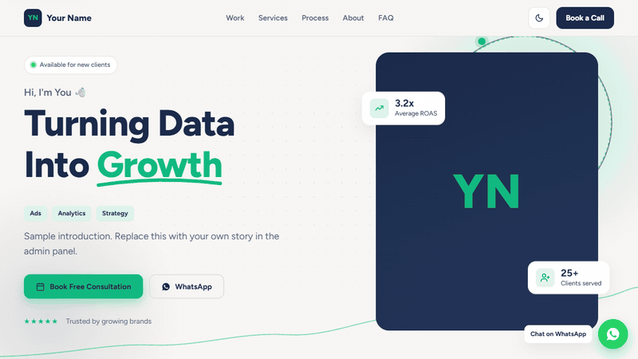
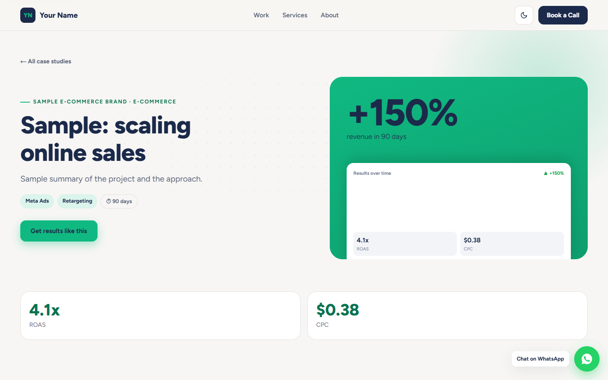

# Marketing Portfolio — template

A portfolio template for digital-marketing freelancers: a **public website** plus a **separate admin panel** where the owner edits everything (hero, results, case studies, services, testimonials, FAQ, settings) and reads contact-form messages. Built with **Next.js + Tailwind + Supabase**, deployable on **Vercel**, free to start and ready for a custom domain.



> This repo contains **placeholder content only**. A real person's data lives in their own private deployment and database. Never commit real content, photos, keys or `.env*` files. The pictures in this README were taken from the placeholder content.

| Home page | On a phone |
|---|---|
|  |  |

| Case studies | Services |
|---|---|
|  |  |



## What you get

| App | Address (example) | For |
|---|---|---|
| `apps/web` | `https://yourdomain.com` | Visitors: home page, case studies, privacy page, consultation form, WhatsApp button |
| `apps/admin` | `https://admin.yourdomain.com` | The owner: edit content, upload images, drag to reorder, read the inbox |

**Website:** responsive from 280 px to 4K, scroll animations, light/dark mode, SEO (sitemap, share image, structured data), optional Meta Pixel and Google Analytics, spam-protected consultation form.
**Admin:** email and password sign-in with password reset, edit every section, image uploads (shrunk automatically), drag-to-reorder, inbox with replied/archived/spam, private notes and email alerts.

## Contents

1. [Quick start (free)](#quick-start-free)
2. [Environment variables](#environment-variables)
3. [Put it online for free (Vercel + Supabase)](#put-it-online-for-free-vercel--supabase)
4. [Keeping the free database awake](#keeping-the-free-database-awake)
5. [Free vs paid: what changes](#free-vs-paid-what-changes)
6. [Using your own domain](#using-your-own-domain)
7. [Email: alerts and password reset](#email-alerts-and-password-reset)
8. [Using a different database](#using-a-different-database)
9. [Hosted Supabase checklist](#hosted-supabase-checklist)
10. [Security model](#security-model) · [Tests](#tests) · [Troubleshooting](#troubleshooting) · [Status](#status)

## Quick start (free)

You need **Node.js 20 or newer** (`node -v`) and a free **Supabase** account (https://supabase.com). Optional: a free **Resend** account (email) and the Supabase CLI (`npx supabase`).

### 1. Install

```bash
npm install
```

### 2. Create the database

1. In Supabase, create a project. Under *Project Settings → API*, note the **Project URL** and the **publishable (anon) key**.
2. Apply the schema. Either:
   - **With the CLI:** `npx supabase link --project-ref YOUR-PROJECT-REF`, then `npx supabase db push --remote`, or
   - **By hand:** open the SQL editor and run the files in `supabase/migrations/` in order (oldest first).
3. Optional sample content: run `supabase/seed/demo_content.sql` in the SQL editor. Skip this for a live site.

### 3. Configure

```bash
cp .env.example apps/web/.env.local
cp .env.example apps/admin/.env.local
```

Fill in both files using the [variables table](#environment-variables). These files are gitignored. Do not commit them.

### 4. Create the admin account

1. Supabase → *Authentication → Users → Add user*: create the owner with an email and a strong password.
2. In the SQL editor, make that user an admin (the only way to add one; there is no API path):

   ```sql
   insert into public.admins (user_id)
   select id from auth.users where email = 'you@example.com';
   ```

### 5. Run it

```bash
npm run dev:web     # website  → http://localhost:3000
npm run dev:admin   # admin    → http://localhost:3001
```

Sign in at http://localhost:3001/login. Changes show on the website within about a minute.

## Environment variables

| Variable | App | What to put |
|---|---|---|
| `NEXT_PUBLIC_SUPABASE_URL` | both | Your project URL |
| `NEXT_PUBLIC_SUPABASE_ANON_KEY` | both | The publishable (anon) key. **Never** the `service_role` / secret key |
| `NEXT_PUBLIC_SITE_URL` | both | Public website address, e.g. `https://yourdomain.com` (`http://localhost:3000` locally) |
| `NEXT_PUBLIC_ADMIN_URL` | both | Admin address, e.g. `https://admin.yourdomain.com` (`http://localhost:3001` locally) |
| `CONTACT_HASH_SALT` | web | Long random string, used to hash visitor IPs for rate limiting |
| `AUTH_HASH_SALT` | admin | Another long random string, for the sign-in limit |
| `RESEND_API_KEY` | web | Optional. Turns on email alerts for new messages |
| `CONTACT_NOTIFY_EMAIL` | web | Where alerts go (up to 3, comma-separated) |
| `RESEND_FROM` | web | Optional sender, e.g. `Website <hello@yourdomain.com>` (needs a verified domain) |
| `CRON_SECRET` | web | Optional. If set, only the daily keep-alive job may call `/api/keepalive` |

Make salts with `node -e "console.log(require('crypto').randomBytes(32).toString('hex'))"`. Keep them secret and different from each other.

**About the `NEXT_PUBLIC_` warning:** Vercel warns about names that start with `NEXT_PUBLIC_` and contain `KEY`. The Supabase URL and publishable key are meant to be public (every browser receives them); your security comes from the database rules. Keep the names exactly as written. Changing any `NEXT_PUBLIC_` value needs a **redeploy**, because they are baked in at build time.

## Put it online for free (Vercel + Supabase)

Both have a free plan that is enough to launch. You get temporary addresses such as `your-project.vercel.app` until you add a domain.

1. **Push the repo to GitHub** (keep it private).
2. **Sign up at https://vercel.com** with GitHub (choose the free *Hobby* plan) and let it see your repo.
3. **Create the website project:** *Add New → Project → Import* your repo.
   - Project Name: e.g. `my-portfolio-web`
   - **Root Directory: `apps/web`** (click *Edit* and choose it)
   - Add the website variables: `NEXT_PUBLIC_SUPABASE_URL`, `NEXT_PUBLIC_SUPABASE_ANON_KEY`, `NEXT_PUBLIC_SITE_URL`, `NEXT_PUBLIC_ADMIN_URL`, `CONTACT_HASH_SALT`
   - Click **Deploy**.
4. **Create the admin project:** import the **same repo again**.
   - Project Name: e.g. `my-portfolio-admin`
   - **Root Directory: `apps/admin`**
   - Variables: `NEXT_PUBLIC_SUPABASE_URL`, `NEXT_PUBLIC_SUPABASE_ANON_KEY`, `NEXT_PUBLIC_SITE_URL`, `NEXT_PUBLIC_ADMIN_URL`, `AUTH_HASH_SALT`
5. **Make the addresses match the variables.** Vercel may give a different address from the one you guessed (for example `my-portfolio-rosy.vercel.app`). Open each project → *Settings → Domains → Add Existing* and add the exact address you put in `NEXT_PUBLIC_SITE_URL` / `NEXT_PUBLIC_ADMIN_URL`. That way no variable needs editing.
6. **Tell Supabase the admin address** (needed for password reset): *Authentication → URL Configuration* → set **Site URL** to the admin address and add `https://your-admin-address/**` under **Redirect URLs**.
7. **Check it:** open the website, send a test message through the form, sign in to the admin, find the message in the Inbox, and delete it.

Nothing runs "all the time" on Vercel. Pages are only built when someone visits, so an unvisited site uses almost nothing. The free plan has monthly limits and no surprise charges. Avoid pushing to the repo more than needed, since each push triggers a build.

## Keeping the free database awake

Supabase's free plan **pauses a project after about a week with no activity**. While paused, the website has no content to show and visitors see a "taking a short break" page.

This template prevents that:

- **Daily keep-alive.** `apps/web/vercel.json` has a daily job that calls `/api/keepalive` on the website. It reads one row and changes nothing. Supabase counts it as activity, so the project doesn't pause. It works on Vercel's free plan (one daily job is allowed).
- **Optional lock.** Add `CRON_SECRET` (any long random text) to the *website* project in Vercel. Vercel then sends it with the daily job, and every other call is refused.
- **Friendly page.** If the database is ever unreachable, `app/error.tsx` and `app/global-error.tsx` show a calm "try again" page instead of a raw error.

**If it ever pauses anyway** (you paused it by hand, or the job was off): open Supabase and click **Restore project**. Your data is kept while paused. Wait a few minutes, then refresh the site. Do not pause the project on purpose before showing the site to someone.

## Free vs paid: what changes

No code changes are needed to move between plans. Prices and limits change, so check each provider's pricing page.

| | Free | Paid |
|---|---|---|
| **Vercel** | *Hobby* plan: for personal, non-commercial use, with monthly limits | *Pro*: needed for a business or client site. More usage, team features, support |
| **Supabase** | Free project: small database and storage, **pauses after a week idle** (see above) | *Pro*: never pauses, daily backups, more space and bandwidth |
| **Resend** (email) | A small monthly allowance, enough for a portfolio | Higher volume |
| **Domain** | Not free: roughly the price of a coffee or two per year | Same |

**Suggested path:** launch free to review and test. When the real business site goes live, move Vercel to Pro (both projects, from the Vercel dashboard), consider Supabase Pro for backups, buy a domain, and connect email.

## Using your own domain

Buy a domain from any registrar (Namecheap, Cloudflare, GoDaddy…). Use the **main** domain for the website and a **subdomain** for the admin.

| Address | Project |
|---|---|
| `yourdomain.com` (and `www.yourdomain.com`) | website (`apps/web`) |
| `admin.yourdomain.com` | admin (`apps/admin`) |

1. **Add the domains in Vercel.** Website project → *Settings → Domains → Add*: `yourdomain.com` (and `www`). Admin project → *Settings → Domains → Add*: `admin.yourdomain.com`.
2. **Add the DNS records Vercel shows you** at your registrar. Vercel displays the exact values for each domain (usually an `A` record for the main domain and a `CNAME` for subdomains). Copy them as shown; they can change. Wait a few minutes for the green tick.
3. **Update the variables in both Vercel projects:**
   - `NEXT_PUBLIC_SITE_URL` = `https://yourdomain.com`
   - `NEXT_PUBLIC_ADMIN_URL` = `https://admin.yourdomain.com`
   Then **redeploy** both projects (*Deployments → ⋯ → Redeploy*).
4. **Update Supabase** (*Authentication → URL Configuration*): Site URL = `https://admin.yourdomain.com`, and add `https://admin.yourdomain.com/**` to Redirect URLs.
5. **Set up email on the domain** (next section).
6. **Check:** the website and admin load over `https://`, the sitemap at `/sitemap.xml` lists your domain, a test form message reaches the admin, and sign-in and password reset work.

The old `*.vercel.app` addresses keep working unless you remove them.

## Email: alerts and password reset

Two separate email jobs:

| Job | Sent by | Needs |
|---|---|---|
| **New-message alerts** to the owner | The website, through Resend | `RESEND_API_KEY`, `CONTACT_NOTIFY_EMAIL`, optional `RESEND_FROM` |
| **Password-reset emails** | Supabase | Supabase's built-in sender (very limited) or your own SMTP |

**Message alerts (Resend):**
1. Create a free account at https://resend.com and an API key (*Sending access*).
2. Add `RESEND_API_KEY` and `CONTACT_NOTIFY_EMAIL` to the *website* project and redeploy.
3. Until you verify a domain, Resend only delivers to the email address you signed up with, so use that address in `CONTACT_NOTIFY_EMAIL`.
4. With a domain: *Resend → Domains → Add*, add the DNS records it shows, wait for verification, then set `RESEND_FROM` to e.g. `Website <hello@yourdomain.com>`.

Alerts are optional. Messages always appear in the admin Inbox either way.

**Password reset:** Supabase's built-in email is limited to a few messages an hour and **only reaches members of your Supabase team**, so a reset for any other address may never arrive. Before going live, connect Resend as the sender: *Supabase → Project Settings → Authentication → SMTP* (host `smtp.resend.com`, username `resend`, password = your Resend API key, sender = an address on your verified domain). Once custom SMTP is on, you can edit the reset email under *Authentication → Emails → Reset Password*. Use this link so it works on any device:

```
{{ .SiteURL }}/auth/confirm?token_hash={{ .TokenHash }}&type=recovery&next=/reset-password
```

## Using a different database

The app is built on **Supabase**, which provides three things: a Postgres database with row-level security, sign-in (Auth), and image storage. Here are your options.

| Option | Effort | Works with the code as-is? |
|---|---|---|
| **A different Supabase project** (another account, region or the paid plan) | Low | Yes |
| **Self-hosted Supabase** (Docker, your own server) | High | Yes, it has the same APIs. Set the URL and keys to your server |
| **Plain Postgres or another service** (Neon, RDS, MySQL, Firebase…) | Very high | **No.** The app talks to Supabase's REST, Auth and Storage APIs, so the data layer, sign-in and uploads would need rewriting |

### Moving to another Supabase project

1. **Create the new project** and note its URL, publishable key and project ref.
2. **Create the schema** in the new project: `npx supabase link --project-ref NEW-REF` then `npx supabase db push --remote`.
3. **Copy the content** from the old project. With the old project linked, export the data of the content tables and run it in the new project's SQL editor:

   ```bash
   npx supabase db dump --remote --data-only --schema public -f content.sql \
     --exclude public.admins --exclude public.contact_messages --exclude public.login_attempts
   ```

   The two single-row tables (`profile`, `site_settings`) already have a row in the new project, so edit those in the admin, or delete the new rows before importing. Check the flags with `npx supabase db dump --help`, as the CLI changes over time.
4. **Copy the images.** Download the `media` bucket and upload it to the new project (the file names are kept, so the database references still work):

   ```bash
   npx supabase storage cp -r --remote --experimental ss:///media ./media-backup
   ```

   Then link the new project and upload the folder back the same way, in the opposite direction.
5. **Create the admin user** in the new project and add it to `public.admins` (see step 4 of the quick start).
6. **Update the variables** in both Vercel projects (`NEXT_PUBLIC_SUPABASE_URL`, `NEXT_PUBLIC_SUPABASE_ANON_KEY`) and **redeploy**.
7. **Repeat the Supabase settings** in the new project: sign-up off, password rules, Site URL and Redirect URLs, SMTP (see the checklist below).

> The data-moving steps above are an outline: run them on a copy first and check the results. The exact CLI flags can differ between versions.

## Hosted Supabase checklist

Set these on supabase.com (the local `supabase/config.toml` only covers local development):

- [ ] **Authentication → Sign In / Providers → Allow new users to sign up: OFF**
- [ ] **Authentication → Settings:** minimum password length **10**; require lowercase, uppercase and digits
- [ ] **Secure password change: ON**
- [ ] **Authentication → URL Configuration:** Site URL = your admin address, and the same address plus `/**` in Redirect URLs
- [ ] **Authentication → SMTP:** custom sender connected (see [Email](#email-alerts-and-password-reset))
- [ ] **Authentication → Emails → Reset Password:** template link updated (needs custom SMTP first)

## Database

The schema lives in [`supabase/migrations/`](supabase/migrations/). Every website section maps to a table the admin edits.

| Table | Drives | Notes |
|---|---|---|
| `profile` | Hero, logo initials, About text | single row |
| `site_settings` | Contact info, socials, SEO, Meta Pixel / GA4, theme colours, form budget options | single row |
| `stats` | Results band (+ hero cards via `show_in_hero`) | value / prefix / suffix / decimals |
| `brands`, `certifications` | Logo marquee, certification badges | |
| `case_studies` + `case_study_images` | Case-study cards and `/work/[slug]` pages | draft / published, card colour, KPI, chart, metrics, screenshots |
| `testimonials` | Quote cards (optionally linked to a case study) | |
| `services`, `process_steps`, `tools`, `about_facts`, `faqs` | Matching sections | `sort_order` + `is_visible` |
| `contact_messages` | Admin inbox (consultation form) | new / read / replied / archived / spam; phone **or** email required |
| `admins` | Who may sign in to the admin | no public sign-up |
| `login_attempts` | Sign-in and reset rate limit | internal; cleared daily |

Validation is also enforced in the database: hex colours, slugs, web addresses (http/https only), emails, WhatsApp digits, GA4 and Pixel IDs, and length limits.

## Security model

Row Level Security is on for every table.

| Who | Can |
|---|---|
| Visitor | Read visible / published content. Send the consultation form only through `submit_contact_message()` (5 per hour per device, 30 per 10 minutes site-wide). Cannot read the inbox, write any table, list uploaded files or see drafts. |
| Signed-in user who is **not** an admin | Exactly the same as a visitor. |
| Admin | Read and edit all content, upload images, manage the inbox (status and private notes only; message text and contact details are locked). Cannot add admins or truncate tables. |

- **Sign-in limit:** 10 sign-in or reset attempts per 15 minutes per device. Only a salted hash of the IP is stored.
- **Reset links:** "set new password" works only within 1 hour of opening a reset email. Signed-in users change their password in *Settings → Password* with the current one.
- **Uploads:** `media` bucket, public URLs, admin-only upload, images only (no SVG), 5 MB max.
- **Headers:** Content-Security-Policy, HSTS, frame blocking and referrer policy on both apps. The admin cannot be embedded in another site and is marked as not for search engines.
- Automated tests for all of the above live in `supabase/tests/`.

## Tests

```bash
npm run test:db     # applies all migrations to an in-memory Postgres and runs supabase/tests/*.test.sql
npm test            # everything: database, website and admin unit tests
npm run lint
npm run typecheck
```

## Troubleshooting

| Symptom | Likely cause and fix |
|---|---|
| "Missing environment variable" on start | Copy `.env.example` to `apps/*/.env.local` and fill in the values. Restart the dev server. |
| Website shows "taking a short break" or no content | The free Supabase project is probably paused. Open Supabase → **Restore project**, wait a few minutes, refresh. |
| Admin sign-in says "Incorrect email or password" for a correct password | Check the user exists under Authentication → Users and is in `public.admins`. |
| "Too many attempts from this device" | Wait 15 minutes. The limit is per device. |
| Reset email never arrives | Supabase's built-in sender only reaches your team. Connect Resend as SMTP. Check spam. |
| Reset link says "expired" | Links last 1 hour and work once. Request a new one. |
| Website changes don't appear | Wait about a minute (the site caches briefly), then refresh. |
| You changed a variable in Vercel but nothing changed | `NEXT_PUBLIC_` values are baked in at build time. **Redeploy** the project. |
| Vercel build fails | Open the failed deployment → *View Build Logs* and read the last lines. Most often a missing variable or the wrong *Root Directory* (it must be `apps/web` or `apps/admin`). |
| Email alerts don't arrive | Check `RESEND_API_KEY`, and that `CONTACT_NOTIFY_EMAIL` is the email your Resend account was created with until your domain is verified. The message still appears in the admin inbox. |

## Status

- [x] Phase 1: foundation (database, security rules, admin sign-in, sample content)
- [x] Phase 2: public website (design, sections, case-study pages, consultation form, responsive design, SEO and tracking)
- [x] Phase 3: admin panel (content editing, drag-to-reorder, image uploads, inbox and email alerts)
- [x] Phase 4: testing, security review, setup guide, database keep-alive

Theme: navy base with an emerald accent (`#10B981`) and a second "highlight" colour. All colours live in `site_settings` (`color_primary`, `color_accent`, `color_highlight`). Change them and the site follows; text on coloured fills is chosen for contrast automatically.

## License

MIT
